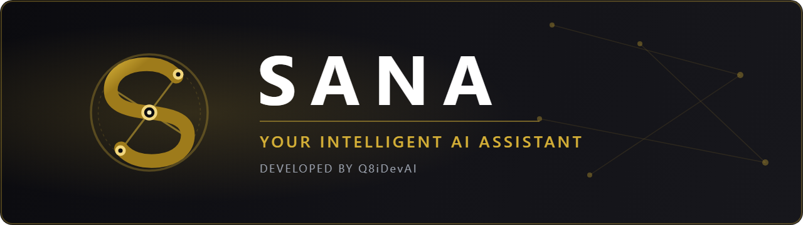

<p align="center">
  
</p>

# SANA
### Tu Asistente de IA Inteligente
Desarrollado por **Q8iDevAI**

<p align="center">
  <a href="LICENSE"></a>
  <a href="https://github.com/Q8iMK/SANA"></a>
  <a href="README.md"></a>
  <a href="README.zh-CN.md"></a>
  <a href="README.ur-pk.md"></a>
</p>

**SANA es un asistente de IA inteligente con mejora continua desarrollado y mantenido por [Q8iDevAI](https://github.com/Q8iMK/SANA)** (basado en *Hermes Agent* de [Nous Research](https://nousresearch.com)). Es el único agente con un bucle de aprendizaje integrado: crea habilidades a partir de la experiencia, las mejora durante el uso, se impulsa a sí mismo a persistir el conocimiento, busca en sus propias conversaciones pasadas y construye un modelo cada vez más profundo de quién eres a lo largo de las sesiones. Ejecútalo en un VPS de $5, un clúster de GPUs o infraestructura sin servidor que cuesta casi nada cuando está inactivo. No está atado a tu laptop — habla con él desde Telegram mientras trabaja en una VM en la nube.

Usa cualquier modelo que quieras — [Nous Portal](https://portal.nousresearch.com), [OpenRouter](https://openrouter.ai) (más de 200 modelos), [NovitaAI](https://novita.ai), [NVIDIA NIM](https://build.nvidia.com) (Nemotron), [Xiaomi MiMo](https://platform.xiaomimimo.com), [z.ai/GLM](https://z.ai), [Kimi/Moonshot](https://platform.moonshot.ai), [MiniMax](https://www.minimax.io), [Hugging Face](https://huggingface.co), OpenAI, o tu propio endpoint. Cambia con `sana model` — sin cambios de código, sin dependencias.

<table>
<tr><td><b>Una interfaz de terminal real</b></td><td>TUI completa con edición multilínea, autocompletado de comandos, historial de conversaciones, interrupción y redirección, y salida de herramientas en streaming.</td></tr>
<tr><td><b>Vive donde tú vives</b></td><td>Telegram, Discord, Slack, WhatsApp, Signal y CLI — todo desde un único proceso gateway. Transcripción de notas de voz, continuidad de conversación entre plataformas.</td></tr>
<tr><td><b>Un bucle de aprendizaje cerrado</b></td><td>Memoria curada por el agente con recordatorios periódicos. Creación autónoma de habilidades tras tareas complejas. Las habilidades mejoran solas durante el uso. Búsqueda FTS5 de sesiones con resumención por LLM para recuperación entre sesiones. Modelado de usuario dialéctico <a href="https://github.com/plastic-labs/honcho">Honcho</a>. Compatible con el estándar abierto de <a href="https://agentskills.io">agentskills.io</a>.</td></tr>
<tr><td><b>Automatizaciones programadas</b></td><td>Planificador cron integrado con entrega a cualquier plataforma. Informes diarios, copias de seguridad nocturnas, auditorías semanales — todo en lenguaje natural, ejecutándose de forma autónoma.</td></tr>
<tr><td><b>Delega y paraleliza</b></td><td>Lanza subagentes aislados para flujos de trabajo paralelos. Escribe scripts de Python que llaman a herramientas vía RPC, convirtiendo pipelines de múltiples pasos en turnos de coste cero de contexto.</td></tr>
<tr><td><b>Funciona en cualquier lugar, no solo en tu laptop</b></td><td>Seis backends de terminal — local, Docker, SSH, Singularity, Modal y Daytona. Daytona y Modal ofrecen persistencia sin servidor — el entorno de tu agente hiberna cuando está inactivo y se activa bajo demanda, costando casi nada entre sesiones. Ejecútalo en un VPS de $5 o un clúster de GPUs.</td></tr>
<tr><td><b>Listo para investigación</b></td><td>Generación de trayectorias en lote, compresión de trayectorias para entrenar la próxima generación de modelos de llamadas a herramientas.</td></tr>
</table>

---

## Instalación rápida

### Linux, macOS, WSL2

```bash
git clone https://github.com/Q8iMK/SANA.git
cd SANA
./setup-sana.sh
```

### Windows (nativo, PowerShell)

> **Nota:** En Windows nativo, SANA funciona sin WSL — la CLI, el gateway, la TUI y las herramientas funcionan de forma nativa. Si prefieres usar WSL2, el comando de Linux/macOS de arriba también funciona allí. ¿Encontraste un error? Por favor [crea un issue](https://github.com/Q8iMK/SANA/issues).

Ejecuta esto en PowerShell:

```powershell
git clone https://github.com/Q8iMK/SANA.git
cd SANA
.\setup-sana.ps1
```

El instalador de código fuente usa PM para Python 3.14, Node.js, npm, pnpm,
ripgrep, FFmpeg y las dependencias de Python. Si falta Git, descarga el archivo
verificado de Git for Windows en el almacén de SANA, sin reemplazar el Git
del sistema.

> **Windows:** Windows nativo es totalmente compatible — el comando de PowerShell de arriba instala todo. Si prefieres usar WSL2, el comando de Linux también funciona allí. La instalación nativa de Windows usa `%LOCALAPPDATA%\sana`; WSL2 instala en `~/.sana` como en Linux. Si ya usabas Hermes, puedes importar tus datos con `sana import-hermes`.

Después de la instalación:

```bash
source ./activate    # o recarga tu shell
sana                 # ¡empieza a chatear!
```

---

## Primeros pasos

```bash
sana                # CLI interactiva — inicia una conversación
sana model          # Elige tu proveedor y modelo LLM
sana tools          # Configura qué herramientas están habilitadas
sana config set     # Establece valores de configuración individuales
sana gateway        # Inicia el gateway de mensajería (Telegram, Discord, etc.)
sana setup          # Ejecuta el asistente de configuración completo
sana import-hermes  # Importa de forma segura datos existentes de Hermes
sana update         # Actualiza a la última versión
sana doctor         # Diagnostica cualquier problema
```

📖 **[Guía de instalación SANA →](docs/sana/INSTALLATION.md)**

---

## Evita la colección de claves API — Nous Portal

SANA funciona con cualquier proveedor que quieras — eso no cambiará. Pero si prefieres no recopilar cinco claves API separadas para el modelo, búsqueda web, generación de imágenes, TTS y un navegador en la nube, **[Nous Portal](https://portal.nousresearch.com)** las cubre todas bajo una sola suscripción:

- **Más de 300 modelos** — elige cualquiera con `/model <nombre>`
- **Tool Gateway** — búsqueda web, generación de imágenes (FAL), texto a voz (OpenAI), navegador en la nube (Browser Use), todo enrutado a través de tu suscripción. Sin cuentas adicionales.

Un comando desde una instalación nueva:

```bash
sana setup --portal
```

Esto te autentica vía OAuth, establece Nous como tu proveedor y activa el Tool Gateway. Comprueba qué está conectado en cualquier momento con `sana portal info`.

Puedes seguir usando tus propias claves por herramienta cuando quieras — el gateway es por backend, no todo o nada.

---

## Referencia rápida: CLI vs Mensajería

SANA tiene dos puntos de entrada: inicia la interfaz de terminal con `sana`, o ejecuta el gateway y habla con él desde Telegram, Discord, Slack, WhatsApp, Signal o Email. Una vez en una conversación, muchos comandos de barra son compartidos entre ambas interfaces.

| Acción                              | CLI                                           | Plataformas de mensajería                                                       |
| ----------------------------------- | --------------------------------------------- | ------------------------------------------------------------------------------- |
| Empezar a chatear                   | `sana`                                        | Ejecuta `sana gateway setup` + `sana gateway start`, luego envía un mensaje al bot |
| Nueva conversación                  | `/new` o `/reset`                             | `/new` o `/reset`                                                                 |
| Cambiar modelo                      | `/model [proveedor:modelo]`                   | `/model [proveedor:modelo]`                                                       |
| Establecer personalidad             | `/personality [nombre]`                       | `/personality [nombre]`                                                           |
| Reintentar o deshacer último turno  | `/retry`, `/undo`                             | `/retry`, `/undo`                                                                 |
| Comprimir contexto / ver uso        | `/compress`, `/usage`, `/insights [--days N]` | `/compress`, `/usage`, `/insights [days]`                                         |
| Explorar habilidades                | `/skills` o `/<nombre-habilidad>`             | `/<nombre-habilidad>`                                                             |
| Interrumpir trabajo actual          | `Ctrl+C` o enviar un nuevo mensaje            | `/stop` o enviar un nuevo mensaje                                                 |
| Estado específico de plataforma     | `/platforms`                                  | `/status`, `/sethome`                                                             |

Para las listas de comandos completas, consulta la [guía de CLI](website/docs/user-guide/cli) y la [guía del Gateway de Mensajería](website/docs/user-guide/messaging).

---

## Documentación

Toda la documentación está en **[website/docs/](website/docs/)**:

| Sección                                                                                             | Contenido                                                    |
| --------------------------------------------------------------------------------------------------- | ------------------------------------------------------------ |
| [Inicio rápido](website/docs/getting-started/quickstart)              | Instalar → configurar → primera conversación en 2 minutos   |
| [Uso de CLI](website/docs/user-guide/cli)                             | Comandos, atajos de teclado, personalidades, sesiones        |
| [Configuración](website/docs/user-guide/configuration)               | Archivo de configuración, proveedores, modelos, todas las opciones |
| [Gateway de Mensajería](website/docs/user-guide/messaging)           | Telegram, Discord, Slack, WhatsApp, Signal, Home Assistant   |
| [Seguridad](website/docs/user-guide/security)                        | Aprobación de comandos, emparejamiento por DM, aislamiento en contenedor |
| [Herramientas y Toolsets](website/docs/user-guide/features/tools)   | Más de 40 herramientas, sistema de toolsets, backends de terminal |
| [Sistema de Habilidades](website/docs/user-guide/features/skills)   | Memoria procedimental, Skills Hub, creación de habilidades   |
| [Memoria](website/docs/user-guide/features/memory)                   | Memoria persistente, perfiles de usuario, mejores prácticas  |
| [Integración MCP](website/docs/user-guide/features/mcp)              | Conecta cualquier servidor MCP para capacidades extendidas   |
| [Programación Cron](website/docs/user-guide/features/cron)           | Tareas programadas con entrega a plataforma                  |
| [Archivos de Contexto](website/docs/user-guide/features/context-files) | Contexto de proyecto que da forma a cada conversación      |
| [Arquitectura](website/docs/developer-guide/architecture)            | Estructura del proyecto, bucle del agente, clases principales |
| [Contribuir](website/docs/developer-guide/contributing)              | Configuración de desarrollo, proceso de PR, estilo de código |
| [Referencia de CLI](website/docs/reference/cli-commands)             | Todos los comandos y flags                                   |
| [Variables de Entorno](website/docs/reference/environment-variables) | Referencia completa de variables de entorno                  |

---

## Migración desde OpenClaw

Si vienes de OpenClaw, SANA puede importar automáticamente tu configuración, memorias, habilidades y claves API.

**Durante la configuración inicial:** El asistente de configuración (`sana setup`) detecta automáticamente `~/.openclaw` y ofrece migrar antes de que comience la configuración.

**En cualquier momento después de instalar:**

```bash
sana plugins install agent-importers  # una vez: OpenClaw, Claude Code, Codex y Cursor
sana claw migrate              # Migración interactiva (preset completo)
sana claw migrate --dry-run    # Vista previa de qué se migraría
sana claw migrate --preset user-data   # Migrar sin secretos
sana claw migrate --overwrite  # Sobreescribir conflictos existentes
```

Qué se importa:

- **SOUL.md** — archivo de personalidad
- **Memorias** — entradas de MEMORY.md y USER.md
- **Habilidades** — habilidades creadas por el usuario → `~/.sana/skills/openclaw-imports/`
- **Lista de comandos permitidos** — patrones de aprobación
- **Configuración de mensajería** — configuración de plataformas, usuarios permitidos, directorio de trabajo
- **Claves API** — secretos en lista de permitidos (Telegram, OpenRouter, OpenAI, Anthropic, ElevenLabs)
- **Assets de TTS** — archivos de audio del espacio de trabajo
- **Instrucciones del espacio de trabajo** — AGENTS.md (con `--workspace-target`)

Consulta `sana claw migrate --help` para todas las opciones, o usa la habilidad `openclaw-migration` para una migración guiada interactiva por el agente con vistas previas de dry-run.

---

## Contribuir

¡Las contribuciones son bienvenidas! Consulta la [Guía de Desarrollo](docs/sana/DEVELOPMENT.md) y [CONTRIBUTING.es.md](CONTRIBUTING.es.md) para la configuración del desarrollo, el estilo de código y el proceso de PR.

---

## Comunidad

- 📚 [Skills Hub](https://agentskills.io)
- 🐛 [Issues (SANA)](https://github.com/Q8iMK/SANA/issues)
- 💡 [Discusiones (SANA)](https://github.com/Q8iMK/SANA/discussions)

---

## Licencia

MIT — ver [LICENSE](LICENSE).

Desarrollado y mantenido por **Q8iDevAI**. Basado en [Hermes Agent](https://github.com/NousResearch/hermes-agent) de [Nous Research](https://nousresearch.com).
