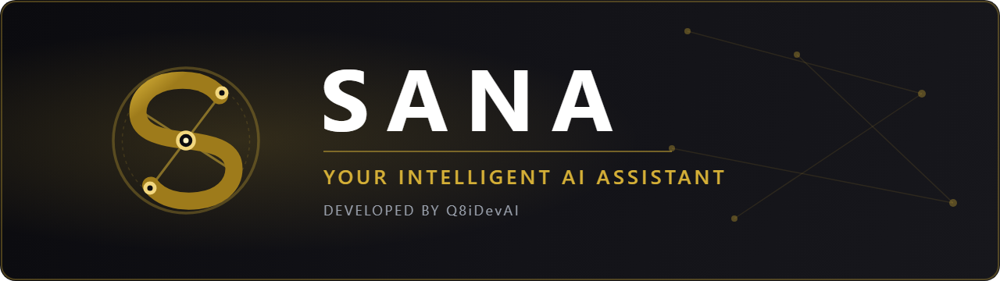

<p align="center">
  
</p>

# SANA
### Your Intelligent AI Assistant
Developed by Q8iDevAI

<p align="center">
  <a href="LICENSE"></a>
  
</p>

**SANA** is an intelligent, self-improving AI assistant developed and maintained by **Q8iDevAI**, featuring a unified black-and-gold identity across CLI (`sana`), TUI, Web Dashboard, Electron Desktop app, multi-platform messaging gateway, skills, plugins, and scheduled automations.

---

## Key Capabilities

- **Unified Interfaces:** Interactive CLI (`sana`), full-featured TUI, Web Dashboard (`sana dashboard`), and native Desktop application (`SANA`).
- **Multi-Model & Provider Agnostic:** Switch models and providers seamlessly with `sana model` — OpenAI, Anthropic, OpenRouter, Nous Portal, local endpoints, and more.
- **Closed Learning Loop:** Persistent memory (`MEMORY.md`, `USER.md`), autonomous skill creation and self-improvement, FTS5 cross-session search, and `agentskills.io` compatibility.
- **Multi-Platform Gateway:** Connect Telegram, Discord, Slack, WhatsApp, Signal, Matrix, and API server from a single gateway (`sana gateway`).
- **Scheduled Automations & Subagents:** Built-in cron scheduler, isolated parallel subagents, and multi-backend terminal execution (Local, Docker, SSH, Modal, Daytona, Vercel Sandbox).
- **Safe Migration from Hermes:** Explicit, idempotent, backup-protected import via `sana import-hermes` without modifying your original Hermes data.

---

## Quick Start

### CLI Usage

```bash
# Start interactive SANA session
sana

# First-time setup wizard
sana setup

# Select model and provider
sana model

# Manage tools and toolsets
sana tools

# Start or manage messaging gateway
sana gateway

# Configuration management
sana config get
sana config set <KEY> <VALUE>

# Diagnostics and updates
sana doctor
sana update

# Import existing Hermes data safely
sana import-hermes --dry-run
sana import-hermes
```

On Windows PowerShell / CMD from a source checkout:

```powershell
.\sana.cmd --help
.\sana.cmd --version
```

---

## Documentation

| Guide | Description |
|---|---|
| [Installation Guide](docs/sana/INSTALLATION.md) | Installing SANA CLI, Desktop, and Web Dashboard on Windows, macOS, and Linux |
| [Development Guide](docs/sana/DEVELOPMENT.md) | Local dev setup, Python/Node environments, building, and testing |
| [Branding Architecture](branding/BRANDING.md) | Central config (`branding/sana.config.json`), idempotent rebranding, and asset pipeline |
| [Brand Asset Guidelines](docs/sana/BRAND_GUIDELINES.md) | Visual palette (`#0B0B0F`, `#D4AF37`, `#17171C`, `#FFFFFF`), logos, and icons |
| [Migration Guide](docs/sana/MIGRATION.md) | Safely importing settings, sessions, skills, plugins, and credentials from Hermes |
| [Upstream Update Guide](docs/sana/UPSTREAM_SYNC.md) | Syncing future updates from `NousResearch/hermes-agent` without losing SANA branding |
| [Troubleshooting](docs/sana/TROUBLESHOOTING.md) | Common issues on Windows, macOS, Linux, and Python/Node toolchains |
| [Verification Report](docs/sana/VERIFICATION_REPORT.md) | Rebranding audit, compatibility decisions, and test verification |

---

## License

SANA is developed and maintained by **Q8iDevAI** and distributed under the [MIT License](LICENSE).
