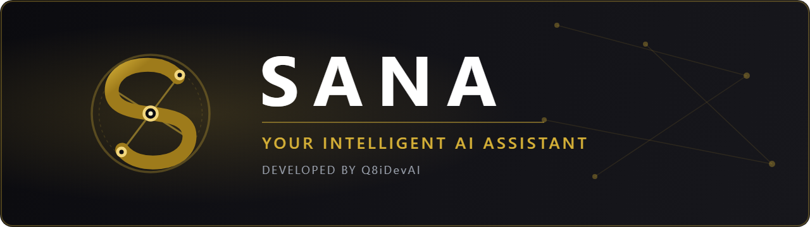

<div dir="rtl">

<p align="center">
  
</p>

# SANA
### آپ کا ذہین اے آئی اسسٹنٹ
**Q8iDevAI** کی جانب سے تیار کردہ

<p align="center">
  <a href="LICENSE"></a>
  <a href="https://github.com/Q8iMK/SANA"></a>
  <a href="README.md"></a>
  <a href="README.es.md"></a>
  <a href="README.zh-CN.md"></a>
</p>

**[Q8iDevAI](https://github.com/Q8iMK/SANA) کا تیار کردہ خود کو بہتر بنانے والا ذہین اے آئی (AI) اسسٹنٹ** ([نوس ریسرچ (Nous Research)](https://nousresearch.com) کے *Hermes Agent* پر مبنی)۔ یہ ایجنٹ سیکھنے کے ایک مکمل عمل (learning loop) کے ساتھ آتا ہے — یہ اپنے تجربات سے نئی مہارتیں (skills) بناتا ہے، استعمال کے دوران ان کو بہتر کرتا ہے، معلومات کو محفوظ رکھنے کے لیے خود کو یاد دہانی کرواتا ہے، اپنی پرانی بات چیت کو تلاش کر سکتا ہے، اور مختلف سیشنز کے دوران آپ کے بارے میں ایک گہری سمجھ پیدا کرتا ہے۔ اسے $5 والے VPS پر چلائیں، GPU کلسٹر پر، یا سرور لیس (serverless) انفراسٹرکچر پر جس کی قیمت استعمال نہ ہونے پر تقریباً صفر ہے۔ یہ آپ کے لیپ ٹاپ تک محدود نہیں ہے — آپ ٹیلی گرام (Telegram) سے اس کے ساتھ بات چیت کر سکتے ہیں جبکہ یہ کلاؤڈ VM پر کام کر رہا ہو۔

آپ اپنی مرضی کا کوئی بھی ماڈل استعمال کر سکتے ہیں — [Nous Portal](https://portal.nousresearch.com)، [OpenRouter](https://openrouter.ai) (200 سے زائد ماڈلز)، [NovitaAI](https://novita.ai) (ماڈل API، ایجنٹ سینڈ باکس، اور GPU کلاؤڈ کے لیے اے آئی مقامی کلاؤڈ)، [NVIDIA NIM](https://build.nvidia.com) (Nemotron)، [Xiaomi MiMo](https://platform.xiaomimimo.com)، [z.ai/GLM](https://z.ai)، [Kimi/Moonshot](https://platform.moonshot.ai)، [MiniMax](https://www.minimax.io)، [Hugging Face](https://huggingface.co)، OpenAI، یا اپنا حسب ضرورت اینڈ پوائنٹ (endpoint) استعمال کریں۔ ماڈل تبدیل کرنے کے لیے صرف `sana model` استعمال کریں — کسی کوڈ کو تبدیل کرنے کی ضرورت نہیں، کوئی پابندی نہیں۔

<table>
<tr><td><b>حقیقی ٹرمینل انٹرفیس</b></td><td>مکمل TUI جس میں ملٹی لائن ایڈیٹنگ، سلیش-کمانڈ آٹو کمپلیٹ، بات چیت کی ہسٹری، انٹرپٹ اور ری ڈائریکٹ، اور سٹریمنگ ٹول آؤٹ پٹ شامل ہے۔</td></tr>
<tr><td><b>یہ وہاں موجود ہے جہاں آپ ہیں</b></td><td>ٹیلی گرام، ڈسکارڈ (Discord)، سلیک (Slack)، واٹس ایپ (WhatsApp)، سگنل (Signal)، اور CLI — سب ایک ہی گیٹ وے پروسیس سے کام کرتے ہیں۔ وائس میمو (Voice memo) ٹرانسکرپشن، کراس پلیٹ فارم بات چیت کا تسلسل۔</td></tr>
<tr><td><b>سیکھنے کا ایک مکمل عمل</b></td><td>ایجنٹ کی اپنی ترتیب دی گئی میموری، جس میں وہ خود کو وقتاً فوقتاً یاد دہانی کرواتا ہے۔ پیچیدہ کاموں کے بعد خود کار طریقے سے مہارت (skill) کی تخلیق۔ استعمال کے دوران مہارتوں میں بہتری۔ LLM سمرائزیشن کے ساتھ FTS5 سیشن سرچ تاکہ پرانے سیشنز کی یاددہانی کی جا سکے۔ <a href="https://github.com/plastic-labs/honcho">Honcho</a> کے ذریعے صارف کی ماڈلنگ۔ <a href="https://agentskills.io">agentskills.io</a> اوپن سٹینڈرڈ کے ساتھ مکمل مطابقت۔</td></tr>
<tr><td><b>شیڈول کی گئی خودکار کارروائیاں</b></td><td>بلٹ ان (Built-in) کرون (cron) شیڈیولر جو کسی بھی پلیٹ فارم پر ڈیلیوری کے لیے استعمال ہو سکتا ہے۔ روزانہ کی رپورٹس، رات کے بیک اپس، ہفتہ وار آڈٹس — یہ سب کچھ قدرتی زبان (natural language) میں اور بغیر کسی نگرانی کے کام کرتا ہے۔</td></tr>
<tr><td><b>کام کی تقسیم اور متوازی عمل</b></td><td>متوازی (parallel) کاموں کے لیے الگ سے ذیلی ایجنٹس (subagents) بنائیں۔ پائتھون (Python) سکرپٹس لکھیں جو RPC کے ذریعے ٹولز کو استعمال کریں، تاکہ کئی مراحل پر مشتمل کاموں کو بغیر کسی سیاق و سباق (context) کے خرچ کے، ایک ہی باری میں انجام دیا جا سکے۔</td></tr>
<tr><td><b>کہیں بھی چلائیں، صرف اپنے لیپ ٹاپ پر نہیں</b></td><td>چھ (Six) ٹرمینل بیک اینڈز — لوکل، Docker، SSH، Singularity، Modal، اور Daytona۔ ڈیٹونا (Daytona) اور موڈل (Modal) سرور لیس (serverless) فعالیت پیش کرتے ہیں — جب آپ کا ایجنٹ فارغ ہوتا ہے تو اس کا ماحول سلیپ (hibernate) ہو جاتا ہے اور ضرورت پڑنے پر خود بخود جاگ جاتا ہے، جس کی وجہ سے سیشنز کے درمیان لاگت تقریباً صفر رہتی ہے۔ اسے $5 والے VPS یا GPU کلسٹر پر چلائیں۔</td></tr>
<tr><td><b>تحقیق کے لیے تیار</b></td><td>بیچ (Batch) ٹریجیکٹری (trajectory) جنریشن، اگلی نسل کے ٹول کالنگ ماڈلز کی تربیت کے لیے ٹریجیکٹری کمپریشن۔</td></tr>
</table>

---

## فوری انسٹالیشن (Quick Install)

### لینکس (Linux)، میک او ایس (macOS)، ڈبلیو ایس ایل ٹو (WSL2)

<div dir="ltr">

```bash
git clone https://github.com/Q8iMK/SANA.git
cd SANA
./setup-sana.sh
```

</div>

### ونڈوز (نیٹو، پاور شیل)

> **توجہ فرمائیں:** مقامی ونڈوز (Native Windows) پر SANA بغیر WSL کے چلتا ہے — CLI، گیٹ وے، TUI، اور ٹولز سب مقامی طور پر کام کرتے ہیں۔ اگر آپ WSL2 استعمال کرنا پسند کرتے ہیں، تو اوپر دی گئی لینکس/میک او ایس کی کمانڈ وہاں بھی کام کرے گی۔ کوئی مسئلہ نظر آیا؟ براہ کرم [مسائل (issues) درج کریں](https://github.com/Q8iMK/SANA/issues)۔

اسے پاور شیل (PowerShell) میں چلائیں:

<div dir="ltr">

```powershell
git clone https://github.com/Q8iMK/SANA.git
cd SANA
.\setup-sana.ps1
```

</div>

سورس انسٹالر Python 3.14، Node.js، npm، pnpm، ripgrep، FFmpeg اور Python کی
ڈیپینڈینسیز کے لیے PM استعمال کرتا ہے۔ اگر Git موجود نہ ہو تو Git for Windows
کا تصدیق شدہ آرکائیو SANA کے ٹول اسٹور میں نصب کرتا ہے۔ سسٹم کا Git تبدیل نہیں ہوتا۔

> **ونڈوز (Windows):** مقامی سورس انسٹال کے لیے اوپر دیا گیا PowerShell کمانڈ استعمال کریں۔ WSL2 میں لینکس کمانڈ استعمال ہوتا ہے۔ مقامی ڈیٹا `%LOCALAPPDATA%\sana` میں اور WSL2 کا ڈیٹا `~/.sana` میں ہوتا ہے۔ اگر آپ کے پاس پہلے سے Hermes موجود ہے تو `sana import-hermes` کے ذریعے ڈیٹا محفوظ طریقے سے منتقل کر سکتے ہیں۔

انسٹالیشن کے بعد:

<div dir="ltr">

```bash
source ./activate    # شیل ماحول کو فعال کریں
sana                 # بات چیت شروع کریں!
```

</div>

---

## آغاز کریں (Getting Started)

<div dir="ltr">

```bash
sana                # انٹرایکٹو CLI — بات چیت شروع کریں
sana model          # اپنا LLM پرووائیڈر اور ماڈل منتخب کریں
sana tools          # کنفیگر کریں کہ کون سے ٹولز ایکٹو ہیں
sana config set     # انفرادی کنفگ (config) ویلیوز سیٹ کریں
sana gateway        # میسجنگ گیٹ وے شروع کریں (ٹیلی گرام، ڈسکارڈ، وغیرہ)
sana setup          # مکمل سیٹ اپ وزرڈ چلائیں (یہ سب کچھ ایک ساتھ کنفیگر کر دے گا)
sana import-hermes  # پرانے Hermes ڈیٹا کو محفوظ طریقے سے امپورٹ کریں
sana update         # لیٹسٹ ورژن پر اپ ڈیٹ کریں
sana doctor         # کسی بھی مسئلے کی تشخیص کریں
```

</div>

📖 **[SANA انسٹالیشن گائیڈ →](docs/sana/INSTALLATION.md)**

---

## API-کیز اکٹھی کرنے سے بچیں — Nous Portal

SANA آپ کے پسندیدہ پرووائیڈر کے ساتھ کام کرتا ہے — یہ چیز تبدیل نہیں ہو رہی۔ لیکن اگر آپ ماڈل، ویب سرچ، امیج جنریشن، TTS، اور کلاؤڈ براؤزر کے لیے پانچ الگ الگ API کیز جمع نہیں کرنا چاہتے، تو **[Nous Portal](https://portal.nousresearch.com)** ان سب کو ایک ہی سبسکرپشن کے تحت کور کرتا ہے:

- **300+ ماڈلز** — ان میں سے کوئی بھی ماڈل `/model <name>` کے ذریعے منتخب کریں
- **ٹول گیٹ وے (Tool Gateway)** — ویب سرچ، امیج جنریشن (FAL)، ٹیکسٹ ٹو سپیچ (OpenAI)، کلاؤڈ براؤزر (Browser Use)، یہ سب آپ کی سبسکرپشن کے ذریعے چلتے ہیں۔ کسی اضافی اکاؤنٹ کی ضرورت نہیں۔

نئی انسٹالیشن کے بعد بس ایک کمانڈ کی ضرورت ہے:

<div dir="ltr">

```bash
sana setup --portal
```

</div>

یہ آپ کو OAuth کے ذریعے لاگ ان کرواتا ہے، Nous کو آپ کا پرووائیڈر مقرر کرتا ہے، اور ٹول گیٹ وے کو آن کر دیتا ہے۔ `sana portal info` کمانڈ استعمال کر کے آپ کسی بھی وقت چیک کر سکتے ہیں کہ کون کون سی سروسز منسلک ہیں۔

آپ اب بھی کسی بھی ٹول کے لیے اپنی مرضی کی API کیز استعمال کر سکتے ہیں — گیٹ وے ہر سروس کے لیے الگ الگ کام کرتا ہے، ایسا نہیں کہ یا تو سب کچھ استعمال کریں یا کچھ بھی نہیں۔

---

## CLI بمقابلہ میسجنگ فوری حوالہ

SANA کے دو بنیادی انٹر فیس ہیں: آپ ٹرمینل UI کو `sana` کے ساتھ شروع کریں، یا گیٹ وے چلا کر اس کے ساتھ ٹیلی گرام، ڈسکارڈ، سلیک، واٹس ایپ، سگنل، یا ای میل کے ذریعے بات کریں۔ جب آپ کسی بات چیت میں ہوتے ہیں، تو بہت سی سلیش (slash) کمانڈز دونوں انٹرفیسز میں ایک جیسی ہوتی ہیں۔

<div dir="ltr">

| کارروائی (Action)                         | سی ایل آئی (CLI)                              | میسجنگ پلیٹ فارمز (Messaging platforms)                                        |
| --------------------------------------- | --------------------------------------------- | -------------------------------------------------------------------------------- |
| بات چیت شروع کریں                       | `sana`                                        | `sana gateway setup` اور `sana gateway start` چلائیں، پھر بوٹ کو میسج بھیجیں   |
| نئی بات چیت شروع کریں                   | `/new` یا `/reset`                            | `/new` یا `/reset`                                                               |
| ماڈل تبدیل کریں                         | `/model [provider:model]`                     | `/model [provider:model]`                                                        |
| پرسنلٹی (Personality) سیٹ کریں           | `/personality [name]`                         | `/personality [name]`                                                            |
| پچھلی باری کو دوبارہ یا منسوخ (undo) کریں | `/retry`، `/undo`                             | `/retry`، `/undo`                                                                |
| کانٹیکسٹ (context) کمپریس کریں / استعمال چیک کریں | `/compress`، `/usage`، `/insights [--days N]` | `/compress`، `/usage`، `/insights [days]`                                        |
| مہارتیں (Skills) براؤز کریں             | `/skills` یا `/<skill-name>`                  | `/<skill-name>`                                                                  |
| موجودہ کام کو روکیں                     | `Ctrl+C` دبائیں یا نیا میسج بھیجیں            | `/stop` یا نیا میسج بھیجیں                                                       |
| پلیٹ فارم کے لحاظ سے سٹیٹس              | `/platforms`                                  | `/status`، `/sethome`                                                            |

</div>

مکمل کمانڈ لسٹ کے لیے، [CLI گائیڈ](website/docs/user-guide/cli) اور [میسجنگ گیٹ وے گائیڈ](website/docs/user-guide/messaging) دیکھیں۔

---

## دستاویزات (Documentation)

تمام دستاویزات **[website/docs/](website/docs/)** پر موجود ہیں:

<div dir="ltr">

| سیکشن (Section)                                                                                     | تفصیل (What's Covered)                                     |
| --------------------------------------------------------------------------------------------------- | ---------------------------------------------------------- |
| [فوری آغاز (Quickstart)](website/docs/getting-started/quickstart)     | انسٹالیشن → سیٹ اپ → 2 منٹ میں پہلی بات چیت شروع کریں       |
| [CLI کا استعمال](website/docs/user-guide/cli)                         | کمانڈز، کی بائنڈنگز (keybindings)، پرسنلٹیز (personalities)، سیشنز |
| [کنفیگریشن (Configuration)](website/docs/user-guide/configuration)    | کنفگ فائل، پرووائیڈرز، ماڈلز، اور تمام آپشنز               |
| [میسجنگ گیٹ وے](website/docs/user-guide/messaging)                    | ٹیلی گرام، ڈسکارڈ، سلیک، واٹس ایپ، سگنل، ہوم اسسٹنٹ         |
| [سیکیورٹی (Security)](website/docs/user-guide/security)              | کمانڈ کی منظوری، DM پیئرنگ (pairing)، کنٹینر آئسولیشن       |
| [ٹولز اور ٹول سیٹس](website/docs/user-guide/features/tools)          | 40 سے زائد ٹولز، ٹول سیٹ سسٹم، ٹرمینل بیک اینڈز             |
| [مہارتوں کا سسٹم (Skills System)](website/docs/user-guide/features/skills)| پروسیجرل (Procedural) میموری، سکلز ہب، نئی مہارتیں بنانا    |
| [میموری (Memory)](website/docs/user-guide/features/memory)            | مستقل میموری، یوزر پروفائلز، بہترین طریقہ کار              |
| [MCP انضمام (Integration)](website/docs/user-guide/features/mcp)      | صلاحیتوں کو بڑھانے کے لیے کسی بھی MCP سرور کو جوڑیں        |
| [کرون (Cron) شیڈیولنگ](website/docs/user-guide/features/cron)         | پلیٹ فارم ڈیلیوری کے ساتھ شیڈول کیے گئے کام                 |
| [کانٹیکسٹ (Context) فائلز](website/docs/user-guide/features/context-files)| پروجیکٹ کا سیاق و سباق (context) جو ہر بات چیت پر اثر انداز ہوتا ہے |
| [آرکیٹیکچر (Architecture)](website/docs/developer-guide/architecture) | پروجیکٹ کا ڈھانچہ، ایجنٹ لوپ، اہم کلاسز                    |
| [تعاون (Contributing)](website/docs/developer-guide/contributing)     | ڈیویلپمنٹ سیٹ اپ، PR کا طریقہ کار، کوڈنگ کا انداز          |
| [CLI حوالہ جات (Reference)](website/docs/reference/cli-commands)      | تمام کمانڈز اور فلیگز (flags)                              |
| [انوائرمنٹ ویری ایبلز](website/docs/reference/environment-variables)  | مکمل انوائرمنٹ ویری ایبل حوالہ جات                         |

</div>

---

## OpenClaw سے منتقلی

اگر آپ OpenClaw سے منتقل ہو رہے ہیں، تو SANA آپ کی سیٹنگز، یادیں (memories)، مہارتیں (skills)، اور API کیز کو خود بخود امپورٹ کر سکتا ہے۔

**پہلی بار سیٹ اپ کے دوران:** سیٹ اپ وزرڈ (`sana setup`) خود بخود `~/.openclaw` کو پہچان لیتا ہے اور کنفیگریشن شروع ہونے سے پہلے مائیگریٹ (migrate) کرنے کا آپشن دیتا ہے۔

**انسٹالیشن کے بعد کسی بھی وقت:**

<div dir="ltr">

```bash
sana plugins install agent-importers  # ایک بار: OpenClaw، Claude Code، Codex اور Cursor
sana claw migrate              # انٹرایکٹو مائیگریشن (مکمل پری سیٹ)
sana claw migrate --dry-run    # جائزہ لیں کہ کیا کیا مائیگریٹ ہوگا
sana claw migrate --preset user-data   # حساس معلومات (secrets) کے بغیر مائیگریٹ کریں
sana claw migrate --overwrite  # موجودہ متصادم فائلوں کو اوور رائٹ کریں
```

</div>

جو چیزیں امپورٹ ہوتی ہیں:

- **SOUL.md** — پرسونا (persona) فائل
- **میموریز (Memories)** — MEMORY.md اور USER.md کی اندراجات
- **مہارتیں (Skills)** — صارف کی بنائی گئی مہارتیں → `~/.sana/skills/openclaw-imports/`
- **کمانڈ الاؤ لسٹ (allowlist)** — منظوری کے پیٹرنز (approval patterns)
- **میسجنگ سیٹنگز** — پلیٹ فارم کنفیگریشنز، اجازت یافتہ صارفین، ورکنگ ڈائریکٹری
- **API کیز** — الاؤ لسٹ شدہ حساس معلومات (ٹیلی گرام، OpenRouter، OpenAI، Anthropic، ElevenLabs)
- **TTS اثاثے** — ورک اسپیس کی آڈیو فائلیں
- **ورک اسپیس کی ہدایات** — AGENTS.md (`--workspace-target` کے ساتھ)

تمام آپشنز دیکھنے کے لیے `sana claw migrate --help` استعمال کریں، یا انٹرایکٹو ایجنٹ کی مدد سے مائیگریٹ کرنے کے لیے `openclaw-migration` سکل کا استعمال کریں (جس میں ڈرائی رن (dry-run) پریویوز شامل ہیں)۔

---

## تعاون کریں (Contributing)

ہم آپ کے تعاون کا خیرمقدم کرتے ہیں! ڈیویلپمنٹ سیٹ اپ، کوڈ کے انداز اور PR کے طریقہ کار کے لیے براہ کرم [Development Guide](docs/sana/DEVELOPMENT.md) اور [CONTRIBUTING.md](CONTRIBUTING.md) دیکھیں۔

---

## کمیونٹی (Community)

- 📚 [سکلز ہب (Skills Hub)](https://agentskills.io)
- 🐛 [مسائل (Issues - SANA)](https://github.com/Q8iMK/SANA/issues)
- 💡 [گفتگو (Discussions - SANA)](https://github.com/Q8iMK/SANA/discussions)

---

## لائسنس (License)

MIT — تفصیلات کے لیے [LICENSE](LICENSE) دیکھیں۔

**Q8iDevAI** کی جانب سے تیار کردہ اور برقرار رکھا گیا۔ [نوس ریسرچ (Nous Research)](https://nousresearch.com) کے [Hermes Agent](https://github.com/NousResearch/hermes-agent) پر مبنی۔

</div>
